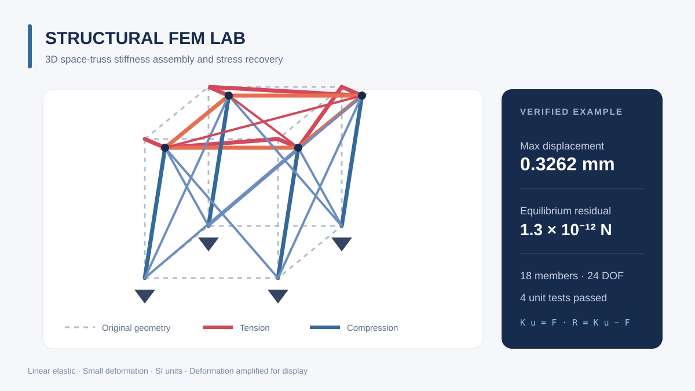
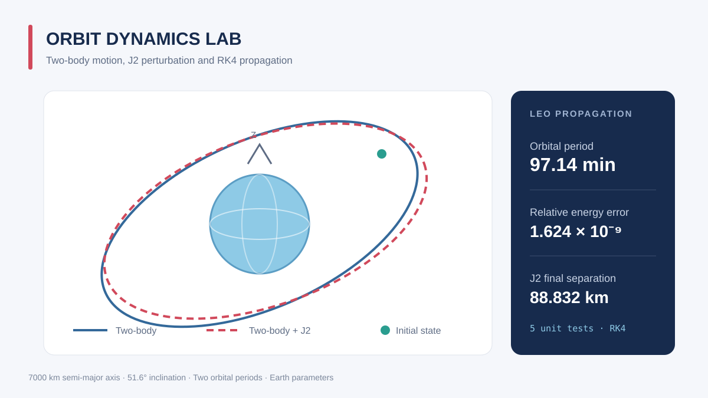
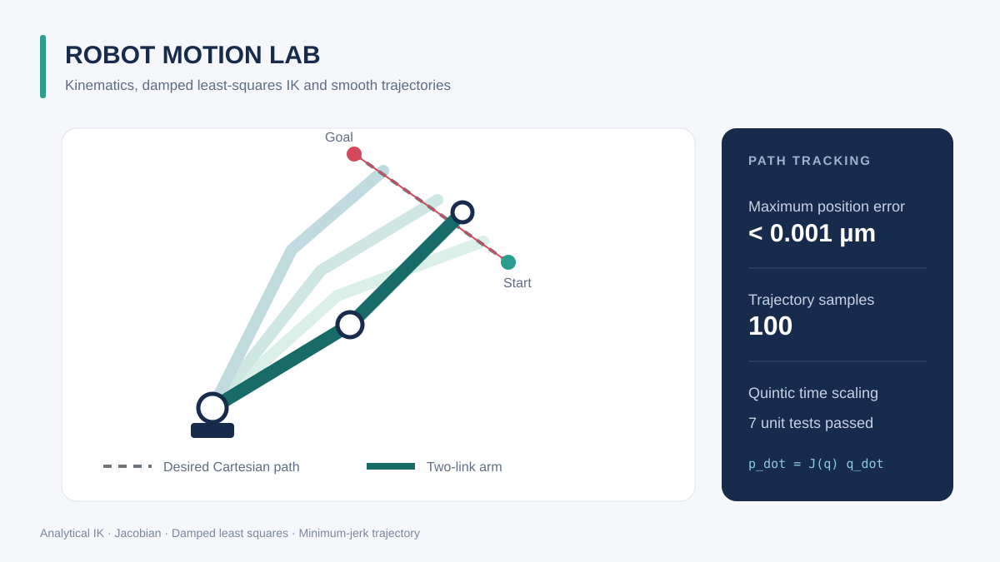

# Mechanics · Aerospace · Robotics Algorithm Portfolio

计算力学、航天动力学与机器人运动算法作品集。仓库中的三个子项目相互独立，均可直接运行，并包含核心算法、单元测试、示例和结果图。


## 项目总览

| 结构力学 | 航天动力学 | 机器人运动 |
| :---: | :---: | :---: |
| [](structural-fem-lab/README.md) | [](orbit-dynamics-lab/README.md) | [](robot-motion-lab/README.md) |
| **[Structural FEM Lab](structural-fem-lab/README.md)** | **[Orbit Dynamics Lab](orbit-dynamics-lab/README.md)** | **[Robot Motion Lab](robot-motion-lab/README.md)** |
| 三维桁架刚度装配、约束求解、支反力与应力恢复 | 二体轨道、J2 摄动、RK4 积分与能量误差分析 | 正逆运动学、雅可比、阻尼最小二乘与平滑轨迹 |

## 快速开始

需要 Python 3.10 或更高版本。以结构力学项目为例：

```bash
cd structural-fem-lab
python -m pip install -r requirements.txt
python -m examples.space_truss
python -m unittest discover -s tests -v
```

另外两个项目只需将目录分别替换为 `orbit-dynamics-lab` 和 `robot-motion-lab`，示例命令为：

```bash
python -m examples.leo_orbit
python -m examples.planar_arm
```

每个示例都会输出关键数值指标，并在本地 `docs/images/` 下生成完整结果图。仓库中的 SVG 为轻量项目封面，运行示例会生成更高信息密度的 PNG 图像。

## 测试与验证

本仓库共有 16 项单元测试：

- 结构力学：解析解、整体平衡、机构奇异性与输入检查
- 轨道动力学：圆轨道速度、周期回归、能量守恒、J2 与撞击检测
- 机器人：解析逆解、雅可比有限差分、路径跟踪与轨迹边界条件

GitHub Actions 会在每次推送后自动运行全部测试和示例。

## 仓库结构

```text
structural-fem-lab/    三维空间桁架有限元求解器
orbit-dynamics-lab/    二体与 J2 轨道传播
robot-motion-lab/      平面机械臂运动学与轨迹
profile/README.md      可选的 GitHub 个人主页展示模板
GitHub使用指南.md      中文 GitHub 新手指南
.github/workflows/     统一自动测试流程
```

## 说明

这些项目用于算法学习、课程作业和研究原型验证，不替代经过工程认证的商业仿真或控制软件。各子项目的数学模型、单位、适用范围和后续扩展方向见其 `README.md`。

GitHub 新手可先阅读[中文使用指南](GitHub使用指南.md)。如需让个人主页直接展示作品集，可参考 `profile/README.md` 中说明创建与用户名同名的特殊仓库。
