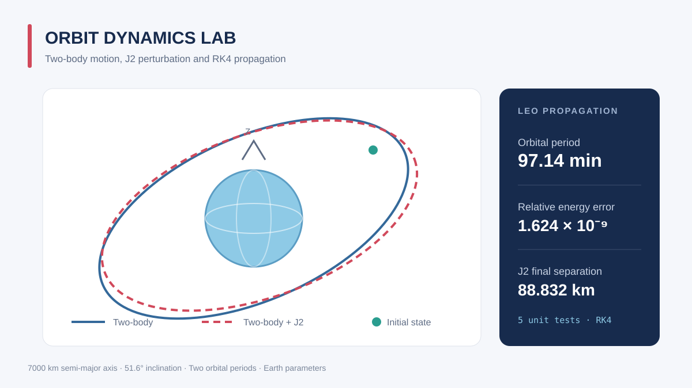

# Orbit Dynamics Lab

一个轻量级轨道动力学项目，用 NumPy 实现开普勒轨道要素转换、二体运动、J2 摄动和 RK4 数值积分，并对数值结果进行能量守恒检查。



## 功能

- 经典开普勒轨道要素转惯性系位置／速度
- 圆形与椭圆形轨道的二体动力学
- 地球非球形引力 J2 项加速度
- 固定最大步长的四阶 Runge–Kutta 积分
- 轨道周期、比机械能、高度历史与数值误差计算
- 撞击中心天体表面时自动终止
- 三维轨迹及对比图、完整单元测试

## 动力学模型

惯性系状态为 `X = [r, v]`，基本方程为：

```text
r_dot = v
v_dot = -mu r / |r|^3 + a_J2
```

J2 加速度采用标准带谐项模型，其中 `R` 为中心天体参考半径，`z` 为惯性系极轴坐标：

```text
a_J2 = 3 J2 mu R^2 / (2 |r|^5) *
       [x(5z^2/|r|^2 - 1),
        y(5z^2/|r|^2 - 1),
        z(5z^2/|r|^2 - 3)]
```

积分器使用经典 RK4。示例同时比较纯二体和加入 J2 后的轨迹，并用纯二体比机械能相对误差监控数值积分质量。

## 快速开始

需要 Python 3.10 或更高版本。

```bash
git clone https://github.com/shanghaiLiyuu/orbit-dynamics-lab.git
cd orbit-dynamics-lab
python -m pip install -r requirements.txt
python -m examples.leo_orbit
```

示例传播一个倾角 51.6°、半长轴 7000 km 的近圆低地球轨道两个周期，输出轨道周期、能量误差和 J2 造成的末端位置差异。

运行测试：

```bash
python -m unittest discover -s tests -v
```

## 修改初始轨道

```python
import numpy as np
from orbit_dynamics import EARTH_J2, OrbitalElements, kepler_to_state, propagate

elements = OrbitalElements(
    semi_major_axis=7_000_000.0,
    eccentricity=0.001,
    inclination=np.deg2rad(51.6),
    raan=0.0,
    argument_of_perigee=0.0,
    true_anomaly=0.0,
)
initial_state = kepler_to_state(elements)
times, states = propagate(initial_state, duration=6000.0, step=20.0, j2=EARTH_J2)
```

长度单位为米，时间单位为秒，角度单位为弧度。默认中心天体参数采用地球值。

## 适用范围与后续方向

当前模型适用于算法研究和快速原型，不考虑高阶重力项、大气阻力、太阳／月球第三体引力、太阳光压、推力或轨道机动。高精度任务应使用经过验证的星历、力模型和自适应积分器。

后续可扩展：Cowell／Encke 法对比、自适应步长、轨道根数反解、摄动项模块化和蒙特卡洛误差传播。
