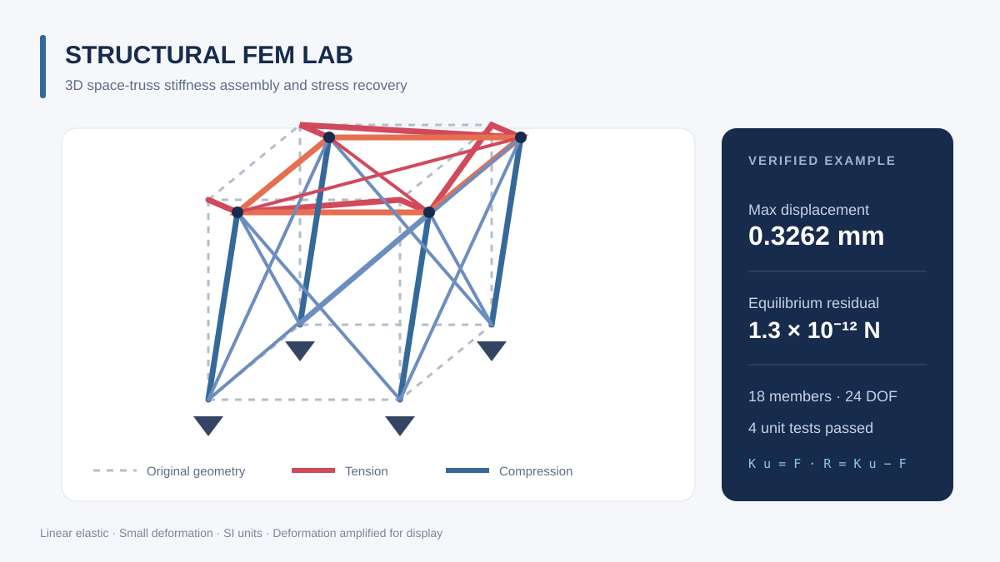

# shanghaiLiyuu

**计算力学 · 航天动力学 · 机器人算法**

关注数值算法从数学模型到可复现代码的完整实现。项目包含中文说明、核心算法、自动测试与结果可视化。

Computational mechanics, orbital dynamics, and robot motion algorithms in Python.

## 精选作品集

[](https://github.com/shanghaiLiyuu/mechanics-aerospace-robotics)

**[mechanics-aerospace-robotics](https://github.com/shanghaiLiyuu/mechanics-aerospace-robotics)** 将三个可独立运行的算法项目合并展示：

- **Structural FEM Lab**：三维桁架刚度装配、约束求解、支反力与应力恢复
- **Orbit Dynamics Lab**：二体轨道、J2 摄动、RK4 积分与能量误差分析
- **Robot Motion Lab**：机械臂正逆运动学、阻尼最小二乘逆解与平滑轨迹

## 技术栈

- **语言与计算：** Python、NumPy
- **可视化：** Matplotlib、三维结果图、SVG 项目封面
- **工程质量：** `unittest`、GitHub Actions、模块化 API
- **正在关注：** 稀疏数值计算、轨道摄动建模、机器人路径与轨迹规划

## 使用方法

```bash
git clone https://github.com/shanghaiLiyuu/mechanics-aerospace-robotics.git
cd mechanics-aerospace-robotics
```

随后进入任一子项目，按其 `README.md` 安装依赖、运行示例和测试。

## 如何启用这个主页模板

GitHub 的特殊规则：创建一个与用户名完全相同的公开仓库，其根目录 `README.md` 会显示在个人主页。

1. 创建公开仓库 `shanghaiLiyuu`。
2. 将本文件内容放入该仓库根目录的 `README.md`。
3. 提交后刷新 `https://github.com/shanghaiLiyuu`。

图片链接已指向 `mechanics-aerospace-robotics` 仓库的 `main` 分支，无需额外上传图片。
