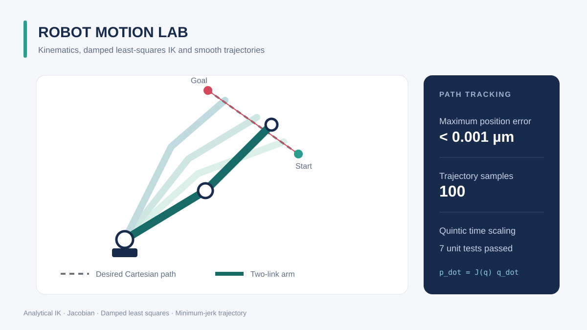

# Robot Motion Lab

一个面向平面串联机械臂的运动学与时序轨迹项目，包含解析逆解、雅可比矩阵、阻尼最小二乘数值逆解，以及最小加加速度 Cartesian 轨迹跟踪。



## 功能

- 任意节数平面旋转关节机械臂的正运动学
- 二连杆机械臂两组 elbow-up／elbow-down 解析逆解
- 平面末端速度雅可比矩阵
- 阻尼最小二乘逆运动学，缓解奇异位形附近的数值问题
- 连续路径的 warm-start 顺序求解
- 五次多项式最小加加速度轨迹及速度、加速度
- 机械臂构型、关节角和跟踪误差可视化

## 核心算法

正运动学通过累计关节角与连杆向量得到各关节位置。末端位置对关节角的雅可比矩阵满足：

```text
p_dot = J(q) q_dot
```

数值逆解采用阻尼最小二乘：

```text
Delta_q = J^T (J J^T + lambda^2 I)^(-1) (p_target - p(q))
```

阻尼项避免直接求逆在奇异位形附近产生过大的关节增量。每个路径点使用上一点解作为初值，降低迭代次数并保持关节轨迹连续。

时间缩放采用五次最小加加速度曲线：

```text
s(tau) = 10 tau^3 - 15 tau^4 + 6 tau^5,  tau = t / T
```

起终点的一阶、二阶导数均为零，因此路径位置、速度和加速度衔接平滑。

## 快速开始

需要 Python 3.10 或更高版本。

```bash
git clone https://github.com/shanghaiLiyuu/robot-motion-lab.git
cd robot-motion-lab
python -m pip install -r requirements.txt
python -m examples.planar_arm
```

示例让二连杆机械臂末端沿直线从 `(1.45, 0.35) m` 移动到 `(0.75, 1.15) m`，并输出最大末端位置误差。

运行测试：

```bash
python -m unittest discover -s tests -v
```

## 代码示例

```python
from robot_motion import PlanarArm, inverse_kinematics_dls

arm = PlanarArm([1.0, 0.8])
initial_guess = [0.5, 0.8]
angles = inverse_kinematics_dls(arm, target=[1.2, 0.7], initial_guess=initial_guess)
print(angles)
print(arm.end_effector(angles))
```

长度单位为米，关节角单位为弧度，时间单位为秒。

## 适用范围与后续方向

当前项目覆盖平面运动学规划，不包含三维姿态、关节限位、碰撞检测、动力学、执行器约束或实时控制。算法输出用于学习和离线验证，实际控制机器人前必须加入限位、碰撞与硬件安全保护。

后续可扩展：三维 DH 建模、关节限位、RRT* 路径规划、时间参数化、动力学与 ROS 2 接口。
