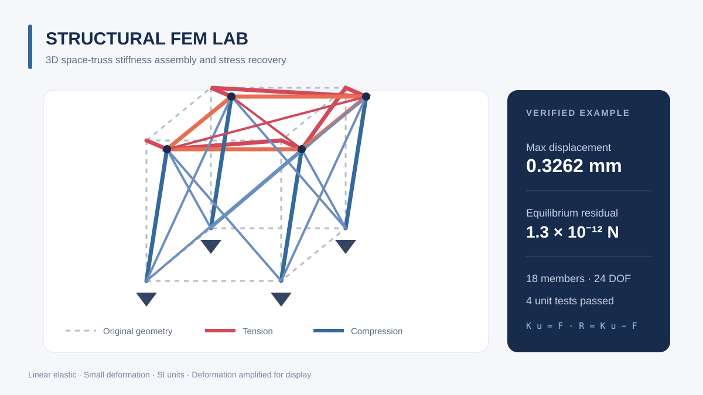

# Structural FEM Lab

一个用 NumPy 编写的三维空间桁架有限元求解器。项目展示从节点与单元数据到整体刚度矩阵、约束求解、支反力和杆件应力的完整计算链路。



## 功能

- 任意三维节点坐标与杆单元连接关系
- 逐杆设置弹性模量和截面积
- 三向节点载荷与任意平动自由度约束
- 自动装配并求解整体刚度方程
- 输出节点位移、支反力、杆件轴力与应力
- 变形放大图和轴力云图，拉力为正、压力为负
- 解析解、整体平衡、机构奇异性和输入检查测试

## 算法

每根杆件只有两个端节点，忽略弯曲与剪切。局部轴向刚度通过方向余弦映射到三维整体坐标：

```text
k = E A / L
T = [ n  -n ; -n  n ],  n = (r_j - r_i) / L
K_e = k T,             K u = F
N = E A / L * n^T (u_j - u_i)
```

其中 `E` 为弹性模量，`A` 为截面积，`L` 为杆长，`n` 为单位方向向量。约束自由度通过缩减方程消除，求解后再由 `R = K u - F` 恢复支反力。

## 快速开始

需要 Python 3.10 或更高版本。

```bash
git clone https://github.com/shanghaiLiyuu/structural-fem-lab.git
cd structural-fem-lab
python -m pip install -r requirements.txt
python -m examples.space_truss
```

终端会输出最大位移、最大拉／压力与整体平衡残差，图像保存至 `docs/images/space_truss.png`。

运行测试：

```bash
python -m unittest discover -s tests -v
```

## 在自己的模型上使用

```python
from truss3d import Member, TrussModel

model = TrussModel(
    nodes=[[0, 0, 0], [2, 0, 0]],
    members=[Member(0, 1, youngs_modulus=200e9, area=1e-4)],
    loads={1: [1000, 0, 0]},
    supports={0: [True, True, True], 1: [False, True, True]},
)
result = model.solve()
print(result.displacements)
print(result.axial_forces)
```

统一使用 SI 单位：米、牛顿、帕斯卡。杆件轴力为正是受拉，为负是受压。

## 项目结构

```text
truss3d/core.py             有限元模型、装配与求解
truss3d/visualization.py    变形与轴力可视化
examples/space_truss.py     空间桁架示例
tests/test_solver.py        单元测试
```

## 适用范围与后续方向

本项目针对小变形、线弹性、铰接杆系，不包含梁弯曲、几何／材料非线性、屈曲或工程规范校核。适合算法学习、课程作业和原型验证，不应直接替代经过验证的工程仿真软件。

后续可扩展：稀疏矩阵、梁单元、特征值屈曲、参数化批量计算和 VTK 结果导出。
